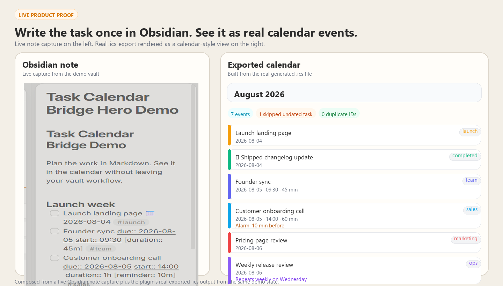
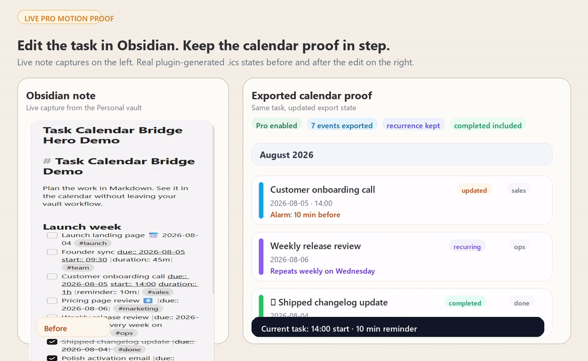
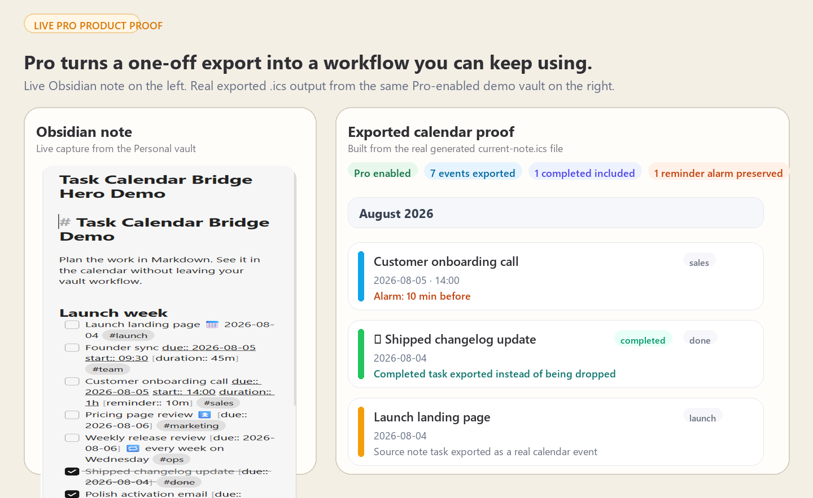

# Task Calendar Bridge

Turn dated Markdown tasks into a calendar you can actually use outside Obsidian.



> Hero image uses a live Obsidian note capture plus the plugin's real exported `.ics` output from the same demo state.

**Works offline** · **One-time payment** · **Unlimited future updates** · **No account**

Task Calendar Bridge turns the dated tasks you already track in Markdown into a standards-based `.ics` calendar for Google Calendar, Apple Calendar, Outlook, TickTick, and anything else that speaks ICS. Write the task once in Obsidian, export it, and see it where you actually plan time.

Best fit if you:
- plan work in Markdown but still live out of a calendar
- want a local/offline workflow instead of another sync service or account
- need task dates to show up in Google Calendar, Apple Calendar, Outlook, TickTick, or mobile widgets

## Free vs Pro at a glance

| | Free | Pro ($9 one-time) |
| --- | --- | --- |
| Current note export | Unlimited | Unlimited |
| Whole-vault export | Next 25 upcoming tasks | Full vault, no cap |
| Timed events, durations, multi-day events | Yes | Yes |
| Obsidian Tasks + Dataview syntax | Yes | Yes |
| Stable event identity | Yes | Yes |
| Repeating events | No | Yes |
| Reminder alarms | No | Yes |
| Auto-export when notes change | No | Yes |
| Publish outside the vault for calendar subscription workflows | No | Yes |
| Completed/cancelled task export | No | Yes |
| Folder filters | No | Yes |

- **Free:** prove the workflow on a real note, export the current note with no cap, and test a small whole-vault feed.
- **Pro:** make it practical for daily use — full-vault export, auto-refresh, recurring events, reminders, publish/subscription workflows, and filtering.
- **Buy once, unlock in seconds:** [Buy Task Calendar Bridge Pro](https://buymeacoffee.com/vaultspotlight/e/560210) — instant checkout, automatic key delivery, offline activation.

## Why Pro is worth paying for

Free proves the bridge works. Pro makes it stop behaving like a manual export toy.

The paid value is not "more settings." It is the difference between:

- exporting one note to test the idea
- keeping a real calendar workflow alive across your vault without babysitting it

If you live out of your calendar, the practical Pro win is:
- your full vault exports instead of only the next 25 upcoming tasks
- the file refreshes itself when notes change
- repeating tasks become real recurring events
- reminders survive the jump into calendar apps
- you can publish the calendar into a cloud folder and subscribe once instead of re-importing forever (see the link forms that actually work, below — iCloud Drive is not one of them)

That is the upgrade story: not "more features," but "this now runs like a real bridge instead of a demo."

### Premium proof to look for

The strongest Pro workflow is:
1. create or edit a dated task in Obsidian
2. export or auto-export the `.ics`
3. subscribe once from your calendar app
4. watch later edits show up without another manual import

If you only need occasional one-off exports, Free is enough. If you want your Markdown task system and your calendar to stay in sync like adults, Pro is the point.



> Motion proof from the same demo note before and after an edit: the customer onboarding call moves from `14:00` with a `10m` reminder to `15:30` with a `30m` reminder, while recurring-event and completed-task proof stays visible on the same export surface.



> Static proof from the live Pro demo state: note capture from the Personal vault on the left, and real `current-note.ics` output from the installed Pro-enabled plugin state on the right. This still shows reminder preservation and completed-task export without faking a SaaS sync layer.

## Why people use it

Obsidian users often plan work in Markdown but still need calendar visibility in Google Calendar, Apple Calendar, Outlook, TickTick, or mobile widgets. The usual alternatives are ugly: copy tasks by hand, maintain a brittle script, or accept some app-specific workflow that breaks the moment you switch tools.

Task Calendar Bridge keeps the workflow simple:
1. write dated tasks in normal Markdown
2. export a standards-based `.ics` calendar file
3. import it once or subscribe to it from the calendar app you already use

No hosted sync layer. No account. No "please trust our server with your planning system."

## First win in 2 minutes

1. Install the plugin.
2. Run `Create sample task note` from the command palette.
3. Run **Export current note tasks to ICS**, then import the generated `.ics` file into your calendar.

If that clicks, Pro unlocks the live version of the workflow: full-vault export, auto-export, recurring events, reminders, publish-outside-the-vault, and folder filtering.

## Task syntax

Both the Obsidian Tasks emoji vocabulary and Dataview-style inline fields work, and you can mix them:

```markdown
- [ ] Simple all-day task 📅 2026-08-01 #work
- [ ] Explicit due date [due:: 2026-08-02]
- [ ] Scheduled beats due for placement ⏳ 2026-08-04 📅 2026-08-06
- [ ] Timed call [due:: 2026-08-02] [start:: 14:15] [duration:: 1h]
- [ ] Multi-day workshop [due:: 2026-08-03] [end:: 2026-08-05]
- [ ] High-priority review ⏫ [due:: 2026-08-07]
- [ ] Weekly one-to-one [due:: 2026-08-03] 🔁 every week on Monday   (Pro)
- [ ] Reminder alarm [due:: 2026-08-02] [start:: 09:00] [reminder:: 10m]   (Pro)
```

- **Dates**: `📅 📆 🗓` due, `⏳` scheduled, `🛫` start, or `[due:: …]`, `[scheduled:: …]`. A scheduled date places the event on the calendar; the due date travels with it as the deadline. Dataview date links (`[due:: [[Daily/2026-08-02]]]`) work too.
- **Times**: `[start:: 14:15]`, `9:30`, or `7:00 pm`. `[duration:: 1h30m]`, `45`, or `1.5h`.
- **Checkbox states**: `[ ]` open, `[/]` in progress, `[x]` done, `[-]` cancelled. Done and cancelled tasks are excluded unless you turn them on (Pro).
- **Repeat rules** (Pro): `every other week`, `every Monday and Friday`, `every month on the first Monday`, `every weekday`, and more. A rule that cannot be translated exactly is reported rather than guessed at.
- **Tags** on the task line become calendar categories you can colour and filter by, in any language — `#work`, `#café`, `#仕事`.
- **Priority** — `🔺 ⏫ 🔼 🔽 ⏬` or `[priority:: high]` — becomes calendar priority.
- Tasks inside code fences are ignored; tasks in callouts, blockquotes, and numbered lists are exported.

**Wondering why a task is missing?** Run **Show last export report**. It lists every skipped task and the reason.

## Free features

- Export every dated task from the current note, with no cap
- Whole-vault export of the next 25 upcoming tasks
- Full Obsidian Tasks and Dataview syntax, tags as categories, priority
- Timed events, durations, and multi-day events
- Time zone handling: keep local wall time, or pin events to a fixed zone with a real `VTIMEZONE`, so times stay right across DST and while you travel
- Stable event identity, so re-importing updates events instead of duplicating them
- Export report that separates what was lost from what was excluded on purpose, with a link to each line
- Optional `obsidian://` links back to the source note, which you can turn off before publishing
- Built-in calendar import and subscription guide, sample note generator
- Offline-first; no account or server

## Pro ($9 one-time)

- Full-vault ICS export with no cap
- Auto-export when notes change
- **Repeating events** — `🔁 every 2 weeks on Monday` becomes a real recurring event
- **Publish outside the vault** — write the calendar into a cloud-synced folder so your calendar app can *subscribe* instead of you re-importing (desktop)
- Reminder alarms via `[reminder:: 10m]`
- Include completed and cancelled tasks
- Include/exclude folder filters
- Offline Ed25519 license verification; no subscription server needed
- One purchase, no expiry, unlimited future updates

### Activate Pro

1. Purchase on [Buy Me a Coffee](https://buymeacoffee.com/vaultspotlight/e/560210).
2. Your license key arrives automatically within seconds — no waiting, no manual delivery.
3. Obsidian → **Settings → Task Calendar Bridge → License key** → paste the key and press **Activate**. Pro unlocks immediately (offline verification).

## Import once, or subscribe?

This matters more than any other setting.

**Importing** an `.ics` file copies the events in once and never looks at the file again — you have to re-import after every change. **Subscribing** points your calendar at a URL and refreshes on its own.

To subscribe, the file has to be reachable over HTTP(S) **and it has to come back as the file itself, not as a web page**. This is where most setups fail: an ordinary cloud "share" link opens a preview page, and a calendar app fed that link reports that it cannot read the calendar.

The Pro **Publish outside the vault** setting writes a copy into any folder you choose. To turn that copy into a link you can subscribe to:

- **Dropbox** — share the file, then change `?dl=0` at the end of the link to `?raw=1`.
- **OneDrive** — share the file, then add `?download=1` to the end of the link.
- **A static host or a GitHub Gist raw URL** — use the direct file URL as-is.
- **iCloud Drive cannot do this.** Its share links are web viewer pages with no direct file URL.

Turn on auto-export and the published copy keeps itself current.

> The exported file carries each task's title, its tags, and — unless you turn off **Link events back to their note** — the note path, line number, and your vault's name. Publish it to an unguessable or access-controlled link rather than a listed one.

| Calendar | Import once | Subscribe |
| --- | --- | --- |
| Google Calendar | Settings → Import & export → Import | Other calendars → + → From URL |
| Apple Calendar | File → Import | File → New Calendar Subscription |
| Outlook (new / web) | Add calendar → Upload from file | Add calendar → Subscribe from web |
| Outlook (classic Windows) | File → Open & Export → Import/Export | Add calendar → Subscribe from web |
| TickTick | Calendar import | Calendar subscription settings |

Refresh intervals are set by the calendar provider, not by this plugin. Google refreshes on its own schedule — often only every several hours, sometimes longer — and Apple Calendar lets you choose. Neither refreshes on demand, so a subscribed calendar always lags the file a little.

## Install

**Community plugins (recommended):** open **Settings → Community plugins**, search **Task Calendar Bridge**, and install it — one click, auto-updates.

### Manual install

1. Download or build the release package.
2. Copy these files into `.obsidian/plugins/task-calendar-bridge/` inside your vault:
   - `main.js`
   - `manifest.json`
   - `styles.css`
3. Enable **Task Calendar Bridge** in Obsidian Settings -> Community plugins.
4. Run `Create sample task note` from the command palette to test it.

## Upgrading to 1.2.0

For almost everyone: nothing to do. Event identity is unchanged, so a calendar
you have already imported or subscribed to keeps updating in place.

Two exceptions:

- **If you tag tasks in a non-ASCII script** — `#cafe` with the accent, `#仕事`,
  `#работа` — those tags used to be half-read, and the leftover characters were
  part of the event title. Fixing that changes the title, and the title is part
  of how an event is identified, so those specific events arrive as new ones.
  A calendar you *subscribe* to sorts itself out on the next refresh. If you
  imported the file by hand, delete the old copies of those events once.
- **If you use Fixed time zone**, timed events now carry a proper `TZID` and the
  file carries a real `VTIMEZONE`, instead of being converted to UTC. That is
  what makes a repeating 09:00 meeting stay at 09:00 after a DST change rather
  than sliding to 08:00. Your calendar app re-renders those events at the
  correct local time on its next refresh; the events themselves are the same
  events.

## Upgrading from 1.0.x

1.1.0 changes how events are identified so that editing a note stops creating duplicate calendar entries. Because the identity scheme itself changed, **the first export after upgrading looks like a new set of events to a calendar you previously imported into.** The cleanest path is to delete the calendar you had imported and import (or subscribe to) the new file once. After that, edits update events in place.

Your configured output path is kept as the whole-vault calendar; current-note exports move to their own file so the two can no longer overwrite each other.

## Development

```bash
npm install
npm test
npm run build
```

## Pro license generation

The private signing key lives at `scripts/.license-private.key` and is ignored by git. Keep it backed up and private.

```bash
npm run license:generate -- customer@email.com
```

The generated key can be pasted into Settings -> Task Calendar Bridge -> License key.
